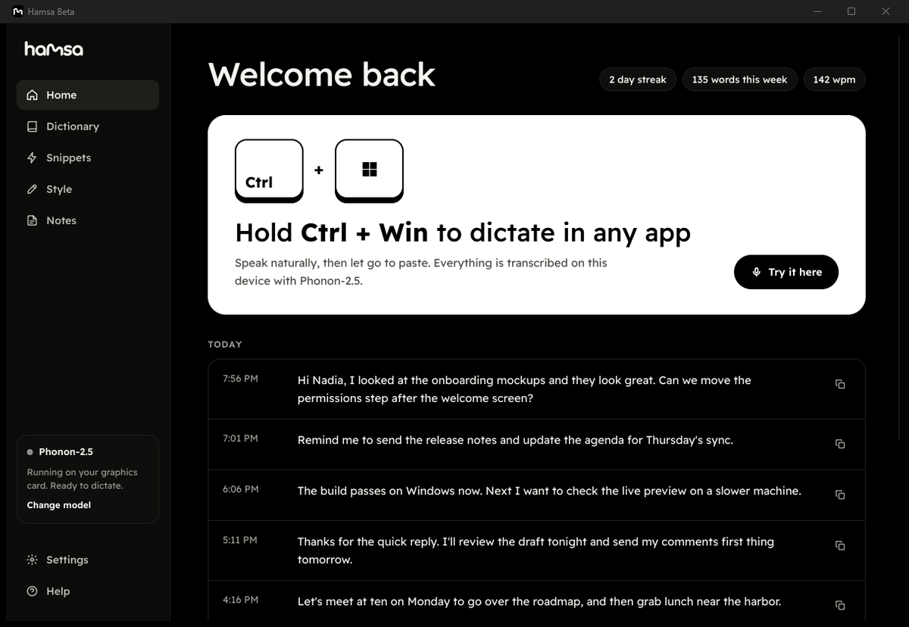
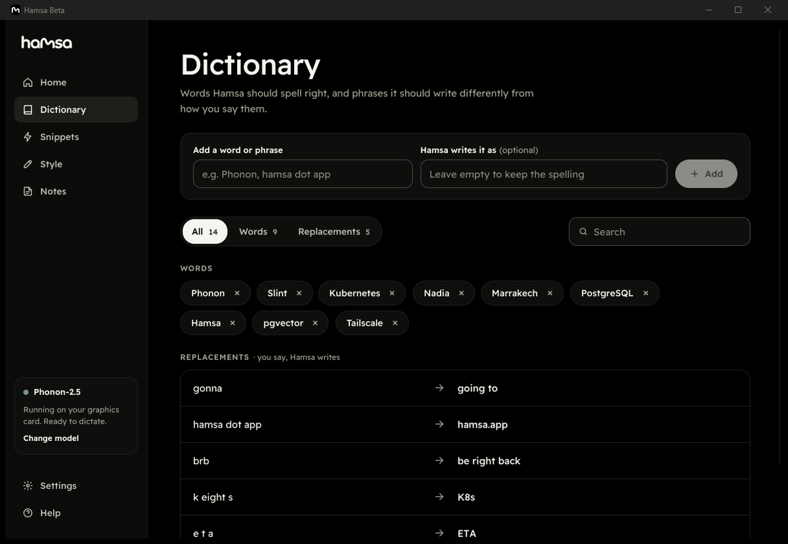
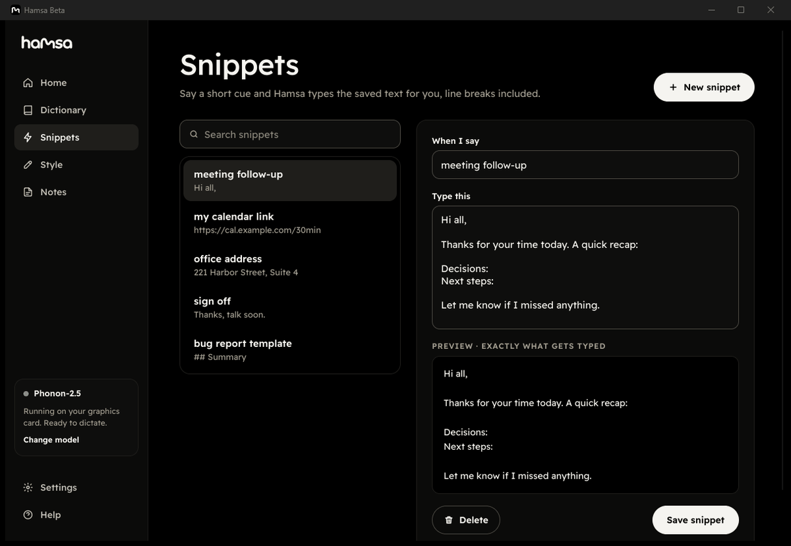
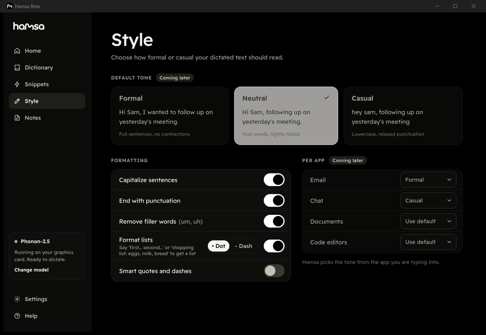
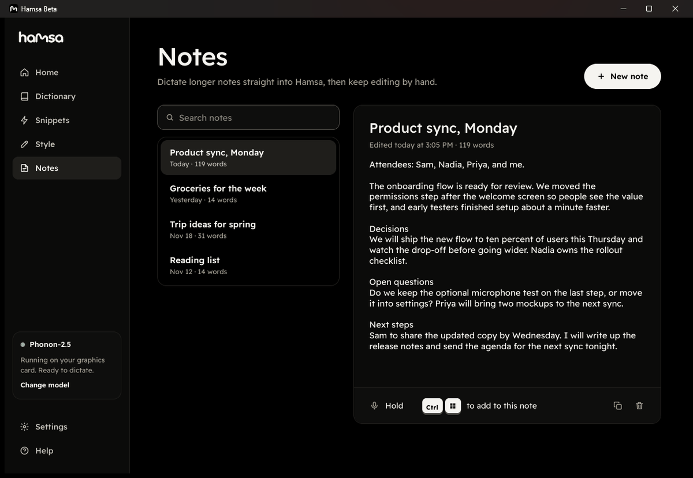
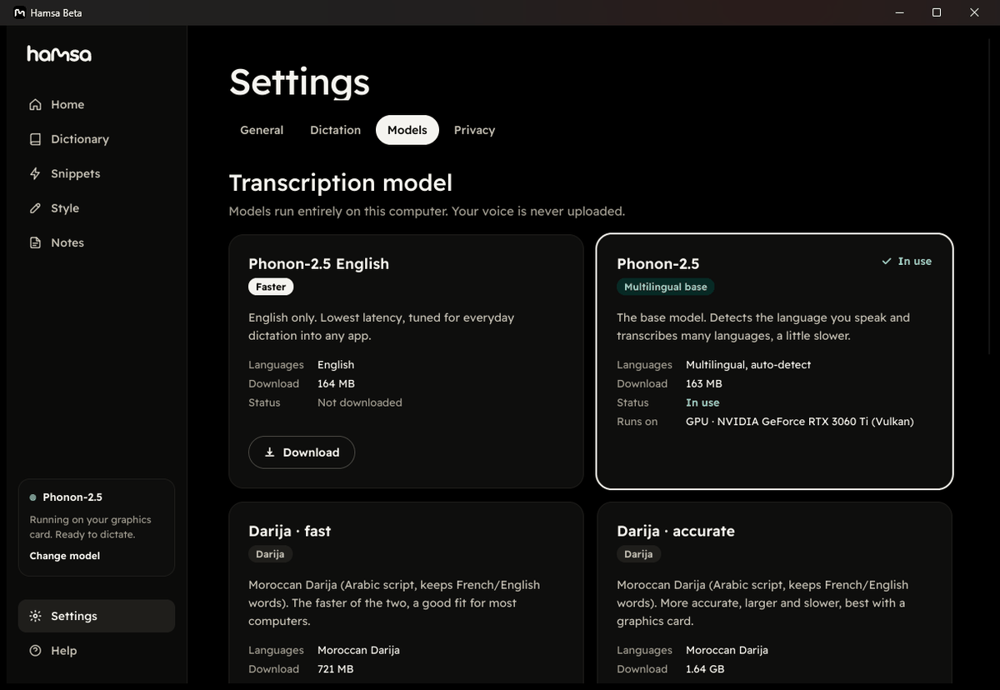
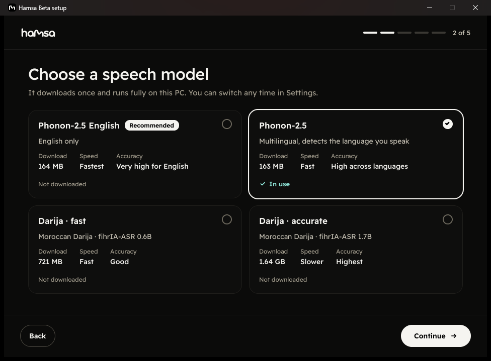
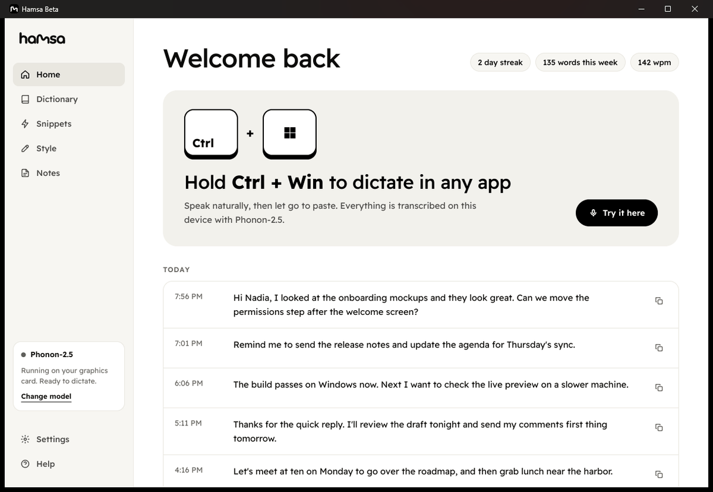
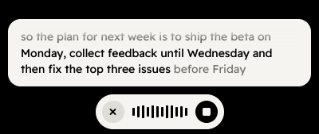
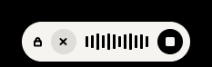

<div align="center">


# Hamsa Beta

**Hold a shortcut, speak, and the text appears wherever you are typing. Fully on your PC.**

**An open-source, fully local alternative to [Wispr Flow](https://wisprflow.ai).** No account, no subscription, your voice never leaves your computer.

[**⬇ Download for Windows**](https://github.com/mostafadrazy/hamsa/releases/latest)

[](LICENSE)


<video controls width="820" poster="https://raw.githubusercontent.com/mostafadrazy/hamsa/main/docs/screenshots/home.png" src="https://raw.githubusercontent.com/mostafadrazy/hamsa/main/docs/media/hamsa-demo.mp4"></video>

[Watch the Hamsa dictation demo (1 min 16 sec)](https://raw.githubusercontent.com/mostafadrazy/hamsa/main/docs/media/hamsa-demo.mp4)

<sub>Music: <a href="https://suno.com/song/89dcf37d-1708-43dd-a6cd-d4181ac2644d">Soft Signal</a>, generated with Suno. The soundtrack is for <a href="https://suno.com/terms">personal, non-commercial use</a>.</sub>

<br>

<a href="https://slint.dev"></a>

</div>

---

Hamsa is a voice-dictation app for Windows. Hold **Ctrl + Win**, say what you want to write, let go, and Hamsa pastes the text into whatever app has focus: your editor, a chat, a browser, an email. The speech engine runs on your own machine, so your voice and your words are never uploaded.

This repository is **Hamsa Beta**, the native Rust version (UI built with [Slint](https://slint.dev)).

## What it does

- **Dictate anywhere.** Hold the shortcut to talk and let go to paste. Or double-tap it for hands-free listening: tap once to finish, press `Esc` to cancel.
- **Live preview.** Your words show up above a small floating bar while you speak. The bar can sit at the bottom or top of the screen, or where you drag it, and can hide while idle.
- **Local and private.** Speech recognition runs on your computer (on the GPU through wgpu when one is available). The internet is used only to download models and, if you switch them on, the optional extras. Dictionary, snippets, notes and history are stored on your PC.
- **Dictionary.** Words Hamsa should spell right, plus replacements ("hamsa dot app" becomes `hamsa.app`). Dictionary words also steer the decoder toward your spelling.
- **Snippets.** Say a short cue and Hamsa types a saved block of text, line breaks included.
- **Style.** Formatting rules you can switch on or off: capitalise sentences, end with punctuation, remove filler words (um, uh), format spoken lists ("first, second..." or "shopping list: eggs, milk, bread" become a bulleted list, with dot or dash bullets), smart quotes and dashes. A default tone and per-app tones are shown on the page but are not usable yet.
- **Notes.** Dictate longer notes straight into Hamsa and keep editing by hand.
- **Smart cleanup (optional, English).** A small local language model, SpeakoFlow Mini, tidies the text after the rules. If it is slow, fails, or changes too much, your text is pasted unchanged.
- **Moroccan Darija (optional).** The fihrIA-ASR speech models (0.6B "fast" and 1.7B "accurate") can replace the default engine, written in Arabic script and keeping French and English words.
- **First-run setup.** A five-step guide picks a speech model, checks the microphone and lets you practise.
- **Start with Windows.** Optionally runs quietly in the tray, ready for the shortcut.
- **Light, dark and system themes**, with an OLED-black dark mode.

## Screenshots

| | |
| --- | --- |
| <br>**Home**: your recent dictations | <br>**Dictionary**: words and replacements |
| <br>**Snippets**: saved text on a spoken cue | <br>**Style**: formatting rules and list formatting |
| <br>**Notes**: dictate and edit | <br>**Settings, Models**: local speech models, Darija included |
| <br>**First-run setup**: choose a speech model | <br>**Light theme** |

### The dictation bar

| Listening | Live preview | Hands-free (locked) |
| :---: | :---: | :---: |
|  |  |  |

<div align="center">

</div>

The screenshots were taken with sample data, not real dictations.

## How it works

```
 microphone ──► Phonon speech engine ──► dictionary ──► formatting ──► optional cleanup ──► paste
 (16 kHz mono)   pure Rust, GPU via       rules and      Style page      SpeakoFlow Mini      into the app
                 wgpu or CPU              replacements   rules           via llama.cpp        you are typing in
```

1. **Capture.** The microphone is recorded (WASAPI) and resampled to 16 kHz mono.
2. **Phonon.** A pure-Rust implementation of the Parakeet-TDT speech model (mel front end, FastConformer encoder, LSTM and TDT decoder), written for the Phonon-2.5 weights. It runs on the GPU through wgpu and has a CPU path.
3. **Dictionary and snippets.** Your words bias the decoder, and replacements and snippets are applied to the text.
4. **Formatting.** The Style rules from the Style page.
5. **Smart cleanup.** Only if switched on, the model is downloaded and the text is English: a small model run by a local `llama-server` (llama.cpp) on `127.0.0.1`.
6. **Paste.** The text is put on the clipboard and pasted into the focused app.

Moroccan Darija models take a different route: fihrIA-ASR runs on the same local llama.cpp helper and replaces Phonon while it is selected.

## Install

Download `Hamsa_Beta_0.1.0_x64-setup.exe` from the [latest release](https://github.com/mostafadrazy/hamsa/releases/latest) and run it. It installs for the current user only and needs no administrator rights. The installer isn't code-signed yet, so Windows SmartScreen may warn you: choose **More info → Run anyway**.

On first start, Hamsa downloads the speech model you choose (about 165 MB for Phonon-2.5).

## Build from source

You need Windows 10/11 and the [Rust toolchain](https://rustup.rs) (stable, 2021 edition). No Node.js or other tools are needed.

```powershell
git clone https://github.com/mostafadrazy/hamsa.git
cd hamsa

# debug build, and run it
cargo build -p hamsa-beta
cargo run -p hamsa-beta

# release build -> target\release\hamsa-beta.exe
cargo build -p hamsa-beta --release
```

To build the installer you also need [NSIS](https://nsis.sourceforge.io) (`makensis`):

```powershell
makensis beta\installer\hamsa-beta.nsi
# -> target\release\Hamsa_Beta_0.1.0_x64-setup.exe
```

Tests: `cargo test -p hamsa-core -p phonon`.

## Usage

| Do this | What happens |
| --- | --- |
| **Hold** Ctrl + Win, speak, release | Dictates and pastes |
| **Double-tap** Ctrl + Win, then let go | Hands-free: keeps listening |
| **Tap** the shortcut while hands-free | Finishes and pastes |
| Press **Esc** while listening | Cancels, nothing is pasted |
| Right-click the bar | Menu: paste or copy the last dictation, toggle live preview and the idle bar, move the bar, open Hamsa, quit |

The shortcut can be changed in Settings, Dictation. Closing the window hides Hamsa to the system tray; quit from the tray icon.

## Privacy

- Audio is processed on your PC and is not uploaded.
- Network access is used only to download models and the llama.cpp helper from Hugging Face and GitHub (checked against pinned SHA-256 hashes), and only when you ask for them. Nothing you say or write is sent.
- Your dictionary, snippets, notes, history and settings are plain JSON files in `%LOCALAPPDATA%\app.hamsa.desktop`. The last recording is kept there as `recordings\last.wav` for troubleshooting. Delete the folder to erase everything.
- There is no account, analytics or telemetry in the code.

## Project layout

| Path | What is in it |
| --- | --- |
| `phonon/` | The speech engine: pure-Rust Parakeet-TDT inference (encoder, decoder, mel, wgpu shaders, dictionary biasing) |
| `core/` | App logic without UI: microphone, hotkey, hands-free, models and downloads, dictionary and snippets, formatting rules, Smart cleanup and Darija via llama.cpp, paste, preferences |
| `beta/` | The Windows app: Slint UI (`beta/ui/*.slint`), window and tray code, the first-run setup, assets and the NSIS installer (`beta/installer/`) |
| `docs/screenshots/` | README images |
| `LICENSE`, `NOTICE.md` | Apache-2.0 text, third-party licenses and credits |

For developers, a few environment variables open screens without clicking: `HAMSA_BETA_PAGE`, `HAMSA_BETA_TAB`, `HAMSA_BETA_THEME`, `HAMSA_BETA_DEMO` and `HAMSA_BETA_SETUP` (see `beta/src/app.rs` and `beta/src/main.rs`).

## Credits and resources

Hamsa stands on other people's work. Full license details are in [NOTICE.md](NOTICE.md).

**Speech and language models** (downloaded by the app, not included in this repository)

- [Phonon-2.5](https://huggingface.co/FermionResearch/Phonon-2.5) and [Phonon-2.5 English](https://huggingface.co/FermionResearch/Phonon-2.5-English) by **Fermion Research**, CC BY 4.0, based on NVIDIA's [Parakeet-TDT 0.6B v3](https://huggingface.co/nvidia/parakeet-tdt-0.6b-v3) (CC BY 4.0). Hamsa's `phonon` crate is an independent Rust inference engine for these models.
- [SpeakoFlow Mini](https://huggingface.co/SpeakoFlow/speakoflow-mini) by **SpeakoFlow**, Apache-2.0, for Smart cleanup. It is fine-tuned from Qwen3.5-0.8B.
- fihrIA-ASR [0.6B](https://huggingface.co/fihriaLab/fihrIA-ASR-0.6B-GGUF) and [1.7B](https://huggingface.co/fihriaLab/fihrIA-ASR-1.7B-GGUF) by **fihrIA lab**, Apache-2.0, Moroccan Darija speech recognition, based on [Qwen3-ASR](https://huggingface.co/Qwen/Qwen3-ASR-0.6B) by the Qwen team.
- [llama.cpp](https://github.com/ggml-org/llama.cpp) by **ggml-org**, MIT, runs the Darija and cleanup models.

**Libraries and tools**

- [Slint](https://slint.dev), the UI toolkit, used under the Slint Royalty-free license (attribution: the badge above and the About Slint widget on the app's Help page).
- [wgpu](https://wgpu.rs) for GPU compute; [winit](https://github.com/rust-windowing/winit) (via Slint) for windows.
- Rust crates, among others: [cpal](https://github.com/RustAudio/cpal) (microphone), [rubato](https://github.com/HEnquist/rubato) (resampling), [hound](https://github.com/ruuda/hound) (WAV), [rayon](https://github.com/rayon-rs/rayon), [realfft](https://github.com/HEnquist/realfft), [matrixmultiply](https://github.com/bluss/matrixmultiply), [zstd](https://github.com/gyscos/zstd-rs), [ureq](https://github.com/algesten/ureq), [arboard](https://github.com/1Password/arboard), [tray-icon](https://github.com/tauri-apps/tray-icon), [serde](https://serde.rs).
- Reference implementations for Phonon: NVIDIA NeMo's Parakeet-TDT and [eschmidbauer/phonon-2.5-c](https://github.com/eschmidbauer/phonon-2.5-c) (MIT).

**Typeface**

- [Readex Pro](https://github.com/ThomasJockin/readexpro) by The Readex Pro Project Authors, SIL Open Font License 1.1.

**Inspiration**

Hamsa is an independent, open-source alternative to [Wispr Flow](https://wisprflow.ai), inspired by it and by Google's on-device dictation work (Google AI Edge Eloquent, Gboard's Rambler). It is not affiliated with or endorsed by their makers, and uses none of their code or assets.

## License

Hamsa Beta is released under the [Apache License 2.0](LICENSE). Copyright 2026 Mostafa Drazi. Third-party components keep their own licenses, listed in [NOTICE.md](NOTICE.md). The speech models are separate works under their own licenses (see above).
